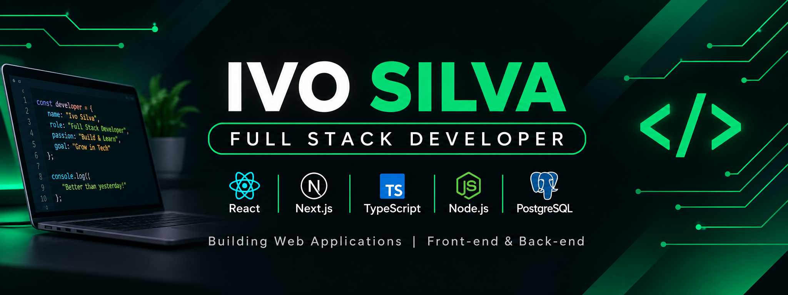

 

  

  

  
  

---

## 👋 Sobre mim

Sou estudante de Análise e Desenvolvimento de Sistemas (ADS), com foco no desenvolvimento de aplicações web.

Tenho experiência prática em projetos com React, Next.js e TypeScript, e estou expandindo minhas habilidades no desenvolvimento de APIs com Node.js, Express e PostgreSQL.

Busco minha primeira oportunidade profissional na área de desenvolvimento de software, onde possa contribuir com projetos reais, aprender com outros desenvolvedores e evoluir tecnicamente.

---

## 🚀 Projetos em Destaque

### ⚙️ Expense Tracker API — Em desenvolvimento

API REST para gerenciamento de despesas, desenvolvida como parte do meu aprofundamento em desenvolvimento back-end.

Atualmente estou trabalhando na construção dos endpoints, integração com PostgreSQL e fundamentos de APIs REST.

#### Tecnologias

* Node.js
* TypeScript
* Express
* PostgreSQL
* SQL

#### Atualmente trabalhando em

* Endpoints GET e POST
* Integração com PostgreSQL
* Consultas SQL parametrizadas
* Criação e consulta de despesas
* Tratamento de requisições e respostas HTTP

🔗 Repositório: https://github.com/ivoalsilva/expense-tracker-api

---

### ✅ To-Do List — Projeto de Portfólio

Aplicação web full stack para gerenciamento de tarefas, desenvolvida com Next.js, React e TypeScript.

#### Destaques

* CRUD de tarefas
* Persistência de dados
* Server Components
* Server Actions
* Interface responsiva
* Integração com banco de dados

#### Tecnologias

* Next.js
* React
* TypeScript
* Tailwind CSS
* PostgreSQL
* Vercel
  
---

### 🛒 Clone Lojas Americanas — Projeto de Portfólio

E-commerce desenvolvido com Next.js, React e Tailwind CSS, com foco na construção de interfaces, componentes reutilizáveis e funcionalidades de uma aplicação de comércio eletrônico.

#### Destaques

* Rotas dinâmicas
* Carrinho de compras com Context API
* Testes E2E com Cypress
* Pipeline CI/CD com GitHub Actions
* Interface responsiva

#### Tecnologias

* Next.js
* React
* TypeScript
* Tailwind CSS
* Cypress
* GitHub Actions

🔗 Repositório: https://github.com/ivoalsilva/clone-lojas-americanas

---

## ⚡ Tecnologias

### Front-end

  

### Back-end

  

### Banco de Dados

  

### Ferramentas

  

---

## 🌱 Atualmente estudando

Atualmente estou aprofundando meus conhecimentos em desenvolvimento back-end, com foco em:

* Node.js e Express
* APIs REST e HTTP
* PostgreSQL e SQL
* Modelagem e integração com bancos de dados
* TypeScript no back-end
* Docker e Docker Compose
* Boas práticas de desenvolvimento e arquitetura de aplicações

---

## 🎓 Formação

📚 Análise e Desenvolvimento de Sistemas (ADS) — Em andamento

🚀 Formação Full Stack — Em andamento
